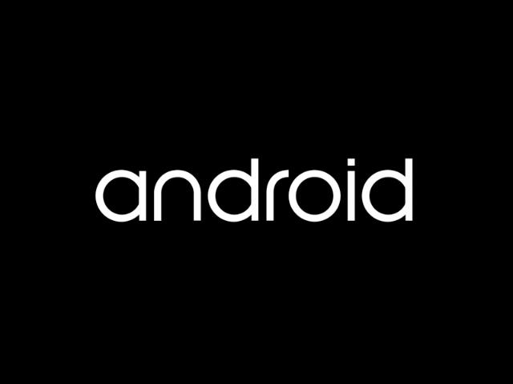

# Porty: 64-bit Android in your web browser

Porty boots a real 64-bit Android, **Android-x86 9.0** (Android 9 "Pie",
x86_64), inside a browser tab on your own device. A PC is emulated by
**QEMU compiled to WebAssembly** ([QEMU-Wasm](https://github.com/ktock/qemu-wasm)),
Android runs on it, and its screen is drawn on a canvas. Porty is just a
static web page: there is no app to install and no server running Android
for you. That is what makes its goal possible: Android in **Safari on an
iPhone**, with no jailbreak, no sideloading and no cloud streaming.

**Try it: [0null0x.github.io/porty](https://0null0x.github.io/porty/)**

Porty is experimental. The page resumes an Android that was booted and
saved in advance: in headless Chrome on the phone setting, Android 9's
home screen is up about a minute after Start. A full boot, without the
saved Android (`resume=0`), takes about 13 minutes on the desktop setting.
On an iPhone, the first try ended in a forced restart while Porty was
loading, most likely for using more memory than iOS allows a tab; phones
now get a smaller setting, and the resume has not been tried there yet.
See [Status](#status).

## Status

As of 2026-11-16, in headless Chrome on a 4-vCPU GitHub runner (the boot
test), the Linux kernel boots, Android's init starts its services, zygote
and SurfaceFlinger run, and the boot animation is drawn on the canvas
after about 25 to 30 minutes (`gfx=vesa`, 800x600, above). Getting there
took three fixes to QEMU-Wasm itself (patches 0005 and 0006) and one to the
page; see [docs/PLAN.md](docs/PLAN.md), "Findings".

Later that day, with a smaller system image (Google's apps removed), no
boot animation and guest time running 8 times slower than real time
(`timescale`, now the default), Android reached `sys.boot_completed` for
the first time in a browser: after 26 minutes on the desktop setting,
20 minutes as a 64-bit-only Android (`diet=2`) and 43 minutes on the
phone setting, which stayed within 1064 MiB of WebAssembly heap. The
screen then showed "Android Setup keeps stopping": the only setup wizard
in the image is Google's. The page now hides it at boot and marks Android
as set up, which also halves the full boot (13 minutes on the desktop
setting), and the site publishes an Android booted to its home screen and
saved: resumed on the phone setting, the home screen is up about a minute
after Start, within 1026 MiB of heap.

The first try in iPhone Safari (2026-11-16) ended in a forced restart while
Porty was loading. iOS may kill a Safari tab that uses much more than about
1.5 GB (WebKit bug 277848), and the phone setting then asked for up to
1.66 GB of WebAssembly memory alone. Phones now give Android 768 MiB of RAM
(1280 MiB of WebAssembly memory in all), QEMU's coroutines use a quarter of
the memory they did, and phones keep fewer compiled code blocks. If Safari
still reloads the tab, the page notices on the next visit, says how far the
last start got, and starts with less memory.

- [x] **M1** CI build is green and the site deploys
- [x] **M2** desktop browser: kernel boot log appears on the serial console
- [x] **M3** desktop browser: Android UI is visible on the canvas (home screen: yes, resumed from the saved Android; a full boot completes after 13 minutes)
- [ ] **M4** touch, navigation buttons and keyboard work
- [ ] **M5** boots in Safari on an iPhone (iOS 26 or later)
- [ ] **M6** performance tuning

## Why Porty

- **It runs on your device, not in the cloud.** Most "online Android
  emulators" run Android on a remote server and stream video of it to your
  browser. Porty downloads the emulator and Android itself and runs both
  inside your tab. The page has no analytics and Android has no network
  inside it, so nothing you do in Android leaves your device.
- **Nothing to install.** No App Store app, no jailbreak, no sideloading
  and no JIT helper. The only code generator involved is the browser's own
  WebAssembly engine, which is why it can run in Safari on an iPhone.
- **A 64-bit Android.** In-browser Android projects built on the v86
  emulator, such as Webdroid, emulate a 32-bit, Pentium 4-class CPU and stop
  at Android 4.4. QEMU emulates a 64-bit x86_64 CPU, so Porty can boot
  Android 9.
- **Open source and static.** GPL-licensed, built by GitHub Actions and
  served from GitHub Pages. Anyone can deploy their own copy; see
  [docs/DEVELOPING.md](docs/DEVELOPING.md).

## Porty and Webdroid

[Webdroid](https://github.com/AttilaTheFun/webdroid-releases) runs
Android-x86 4.4 on the v86 emulator and showed that a browser-hosted Android
on an iPhone is practical. Porty is a 64-bit alternative that trades speed
for a much newer Android.

| | Porty | Webdroid |
| --- | --- | --- |
| Android | 9 (Pie), 64-bit x86_64 | 4.4 (KitKat), 32-bit x86 |
| Emulator | QEMU compiled to WebAssembly | v86 |
| Safari on an iPhone | First try ran out of memory | Works |
| Boot time | 25 to 30 minutes to the boot animation (desktop Chrome) | About a minute (iPhone) |
| Network inside Android | No | No |
| Google Play | No | No |
| Session survives a reload | No | No |

## How it works

- `qemu-system-x86_64`, compiled to WebAssembly, emulates a PC with a
  Nehalem-class x86_64 CPU. QEMU's code translator turns the guest's x86
  code into WebAssembly, which the browser compiles to native code.
- The page downloads Android-x86's kernel and ramdisks and the PC firmware,
  then boots the kernel directly, without a boot menu.
- Android's system image (about 780 MB, compressed) is never downloaded
  whole. A small block driver added to QEMU fetches it in 2 MiB pieces as
  Android reads them, from QEMU's own worker threads, and QEMU unpacks them
  (the image is a compressed qcow2 of the ext4 system partition).
- The guest's video memory is shared with the page, which copies the rows
  that changed onto a canvas every frame. Taps, clicks and keys enter the
  guest as a USB tablet and a keyboard.
- QEMU's threads need `SharedArrayBuffer`, which browsers only allow on
  cross-origin-isolated pages. GitHub Pages cannot send the headers that
  turn this on, so a service worker
  ([coi-serviceworker](https://github.com/gzuidhof/coi-serviceworker)) adds
  them. That is why the page reloads itself once on the first visit.

[docs/PLAN.md](docs/PLAN.md) has the design, the reasoning behind each
decision, the size budget, what to try when a milestone fails and the
findings from every boot attempt so far.

## Using Porty

1. Open **[0null0x.github.io/porty](https://0null0x.github.io/porty/)** in
   desktop Chrome. On the first visit the page reloads itself once; that is
   the service worker enabling cross-origin isolation.
2. Press **Start Android** and keep the tab in the foreground. Expect many
   minutes. The toolbar shows how many MB of the system image have been
   read; while that number keeps growing, Android is still booting.
3. To watch the boot, press **Console**, or open the page with
   [`?serial=1`](#url-parameters). You should see, in order: SeaBIOS text on
   the canvas; Linux kernel messages in the console;
   `Detecting Android-x86... found at /dev/vda`; and eventually the canvas
   switching from text mode to Android's boot animation. Once Android is up,
   the serial console also has a root shell.

The toolbar has **Pause**, **Reset**, **Console** and **Full** (full
screen). Below the screen are Android's **Back**, **Home** and **Recents**
buttons, and **Keyboard** for the on-screen keyboard.

**On an iPhone** (Safari 26 or later): use the plain address with no
parameters, close other tabs and apps, stay on Wi-Fi, plug the phone in and
keep Safari in front with the screen on. If Safari reloads the page, tap
**Start Android** again: the page says how far the last start got and uses
less memory this time. Please [open an issue](https://github.com/0null0x/porty/issues)
and say how far it got, with that message.

### What you need

- **A current browser.** Porty has been run in Chrome so far. Desktop
  Safari and Safari on iPhone (iOS 26 or later) are the next targets; other
  browsers are untested. Private browsing and in-app browsers (inside chat
  or social apps) block service workers, so open the page in Safari or
  Chrome itself.
- **Memory.** By default the tab reserves 2300 MiB of memory on a desktop,
  1024 MiB of which is Android's RAM, and 1280 MiB on a phone (768 MiB for
  Android). Close other tabs and apps first.
- **Bandwidth.** Tens of MB to start, then the parts of the roughly 780 MB
  system image that Android reads while booting (several hundred MB). Use
  Wi-Fi.

## URL parameters

| Parameter | Default | Meaning |
| --- | --- | --- |
| `mem` | 1024 (phones: 768) | Guest RAM in MiB (512 to 3072; 1536 runs QEMU-Wasm out of memory). Any memory parameter (`mem`, `tb`, `cache`, `wasmmem`) turns off the automatic smaller setting on phones |
| `wasmmem` | sized to fit | Size of the WebAssembly memory in MiB |
| `tb` | 384 (phones: 128) | TCG translation cache in MiB |
| `smp` | 1 | Guest CPUs, 1 to 4 (`smp=2` crashes QEMU-Wasm with this guest today) |
| `usb` | on | `0` leaves out the USB tablet (no touch input; for diagnosis) |
| `jit` | 1500 | Runs of a code block in the interpreter before it is compiled to WebAssembly; `0` compiles at once, `2147483647` means interpreter only |
| `jitcap` | 15000 (phones: 4000) | Compiled code blocks kept at once (256 to 15000). Each is a module in the browser's own memory |
| `timescale` | 8 | Guest time runs this many times slower than real time (1 to 16; `1` is real time), so that Android's fixed timeouts (the 60 s system_server Watchdog, "not responding" after 5 to 10 s) allow for a slow emulator. Android's clock falls behind by the same factor. Needs QEMU patch 0011 |
| `jitgc` | on | `0`: dropped compiled blocks stop counting against `jitcap` at once instead of after garbage collection (experiment) |
| `cpu` | `Nehalem` | QEMU CPU model (SSE4.2 and POPCNT, which Android's x86_64 ABI requires; no AVX) |
| `res` | `480x800` | Guest resolution |
| `dpi` | from `res` | Android screen density |
| `gfx` | `auto` | `vesa` adds `nomodeset vga=...` (no kernel mode setting; standard VESA modes only, so portrait sizes become 800x600 or 1024x768) |
| `disk` | `virtio` | `ide` presents the images as IDE CD-ROMs instead |
| `setup` | off | `1` keeps Android's first-run setup wizard, which stops at once in this image (it needs Google's services). By default the page hides the wizard, Android-x86's analytics service and the second launcher (Taskbar) from Android at boot and marks the device as set up once it has booted, so the boot ends on the home screen |
| `serial` | off | `1` opens the serial console at start |
| `cache`, `parallel` | 64 (phones: 16), 4 | 2 MiB disk chunks kept in RAM, concurrent chunk downloads |
| `fps` | 30 | Canvas refresh cap |
| `diet` | 1 | Android properties set at boot to shorten it: `1` no boot animation (the screen stays black until the launcher) and first-boot app preparation without verification; `0` none; `2` also a 64-bit-only Android without the 32-bit zygote (experiment) |
| `props` | | More Android properties, `key=value,key=value` (letters, digits, `.`, `_`, `-`); they override `diet`, for example `props=debug.sf.nobootanimation=0` |
| `lowmem` | 1 | Android's low memory killer (lmkd) keeps background apps until memory is critically short and never ends the app on screen (`ro.lmk.medium=1001`, `ro.lmk.critical=200`). `0` leaves it as shipped: without swap it then ends every app that is left for another within seconds, and each return is a cold start |
| `ttmfix` | 1 | `0` leaves the kernel module `ttm.ko` as shipped. By default the page replaces it at boot with a copy in which 2 bytes differ, because this kernel panics on a warning in `ttm_bo_vm_open` whenever Android collects stack traces (after every "not responding" app); see [docs/PLAN.md](docs/PLAN.md) |
| `resume` | auto | A site that publishes a snapshot resumes the saved, already booted Android instead of booting. `0` always boots; `1` resumes even when the address sets machine parameters (the snapshot's own settings then apply) |
| `append` | | Extra kernel arguments, for example `append=DEBUG=1` |
| `cmdline` | | Replace the whole kernel command line |
| `qemu` | | Extra QEMU arguments |
| `nocoi` | | `1` unregisters the service worker (debugging) |

Example: `https://0null0x.github.io/porty/?serial=1&mem=1024&smp=1&res=1024x768`

## Known limits and risks

- **Speed.** This is full-system emulation without hardware virtualisation,
  and Android 9 renders through a software OpenGL implementation on top of
  it. A boot that takes a native PC seconds will take many minutes here, and
  may not complete at all on a phone. This is the largest risk to M3 and M5.
- **Memory.** The guest's RAM is real memory in the browser tab. iOS Safari
  limits tabs more tightly than desktop browsers; the page falls back to
  smaller guests when the browser refuses the allocation, but a tab that is
  killed later for using too much memory cannot be caught.
- **Download size.** Tens of MB up front, then the parts of the roughly
  780 MB system image that Android touches while booting.
- **Live session only.** `/data` is a RAM disk inside the guest. Reloading
  the page, or the browser discarding the tab, loses everything.
- **No network** in the guest, so also no app installs from the internet.
  No Google Play or Google apps, no cellular, SMS, calls, camera, sound,
  sensors or GPS.
- **One pointer.** Touches are delivered through a USB tablet: Android shows
  a mouse pointer and there are no multi-touch gestures.
- **Text input** from the on-screen keyboard is limited to US-ASCII.
- **Hosting.** GitHub Pages has a 1 GB site limit and a 100 GB/month soft
  bandwidth limit; the site is close to the first. See the size budget in
  the plan.

## Troubleshooting

When something goes wrong the page shows the reason, a hint and the last
lines of the serial console, with a *Copy details* button. If the tips below
do not help, paste those details into an
[issue](https://github.com/0null0x/porty/issues).

**"This page is not cross-origin isolated".** Reload once. If it stays:
private browsing and in-app browsers (inside chat or social apps) block
service workers, so open the address in Safari or Chrome itself. To start
over, open the page with `?nocoi=1`, then without it.

**"The browser could not reserve WebAssembly memory", or the tab reloads by
itself.** Close other tabs and apps. On a phone, just start again: after a
reload the page steps down to 640 and then 512 MiB of guest RAM by itself
(**Use the normal memory setting** goes back). On a desktop, try `?mem=768`
(and, if needed, `?mem=768&tb=128&cache=16`).

**"QEMU exited with status 1".** The last serial lines name the option QEMU
did not like. Remove custom `qemu=`/`cpu=` parameters first.

**The console stops at `Detecting Android-x86....` with more dots
appearing.** The guest cannot see its disk. Try `?disk=ide`.

**The console shows Android starting, but the canvas stays in text mode or
black.** Try `?gfx=vesa`, then `?res=1024x768`, then both.

**It works but crawls.** Try a smaller screen such as `?res=320x480&dpi=120`.

**The kernel crashes or the machine powers off early in boot.** See
"Findings" in [docs/PLAN.md](docs/PLAN.md). `?jit=2147483647` runs the
guest in QEMU's interpreter only, which tells a WebAssembly code-generator
bug apart from everything else.

**After a new deployment the page behaves strangely.** GitHub Pages caches
files for ten minutes; reload after that.

Problems building or deploying your own copy are covered in
[docs/DEVELOPING.md](docs/DEVELOPING.md#troubleshooting-the-build).

## FAQ

**Can Porty run Android on an iPhone?** That is what it is built for, but
not yet: see [Status](#status) for how far Android gets today. The first
try in iPhone Safari ran out of memory; phones now use much less.

**Do I need to jailbreak, sideload or install an app?** No. Porty is a web
page that runs on the browser's own WebAssembly engine, so it needs no App
Store app, no jailbreak, no sideloading and no JIT helper.

**Is it a cloud emulator that streams Android to me?** No. Android runs
inside your browser tab, on your device. The site is static files on GitHub
Pages, the page has no analytics, and Android has no network connection.

**Can I install apps or use Google Play?** No. Android has no internet
connection inside Porty, and there is no way to import an APK. The
Android-x86 9.0-r2 ISO does ship Google's apps (Play services, the Play
Store, Chrome, Gmail and others); Porty removes them from the system image
it publishes, which also saves most of an hour of first-boot work. What is
left of Google's is the WebView and three small packages Android needs to
start (the package installer and the "ext" services).

**Why is it so slow?** Every x86 instruction is translated inside the
browser, without hardware virtualisation, and Android draws its screen in
software. In the boot test each step of Android's start-up takes roughly 10
to 50 times as long as on real hardware.

**Is anything saved?** No. Android's `/data` lives in RAM, so reloading the
page or closing the tab starts over.

**Is Porty made by Google or the Android-x86 project?** No. "Android" is a
trademark of Google LLC. Porty is not affiliated with Google or with the
Android-x86 project.

## Contributing and development

Bug reports and boot logs are welcome in
[Issues](https://github.com/0null0x/porty/issues). The most useful things to
include are the page's *Copy details* text, the URL parameters you used, and
your browser and device.

- [docs/DEVELOPING.md](docs/DEVELOPING.md): deploying your own copy, the CI
  build and the automatic boot test, local tests, repository layout
- [docs/PLAN.md](docs/PLAN.md): design, decisions, size budget, findings
- [web/README.md](web/README.md): what each file of the page does

## Credits

- [QEMU-Wasm](https://github.com/ktock/qemu-wasm) by Kohei Tokunaga: QEMU
  with a code generator that emits WebAssembly. Porty's changes to it are
  the patches in [`patches/qemu-wasm/`](patches/qemu-wasm/).
- [QEMU](https://www.qemu.org/)
- [Android-x86](https://www.android-x86.org/), whose unmodified 9.0-r2 image
  Porty boots
- [coi-serviceworker](https://github.com/gzuidhof/coi-serviceworker),
  [xterm.js](https://github.com/xtermjs/xterm.js) and
  [xterm-pty](https://github.com/mame/xterm-pty)
- [Webdroid](https://github.com/AttilaTheFun/webdroid-releases), Porty's
  design precedent (no code used)

## License

Porty's own files are licensed under the GNU General Public License,
version 2 or (at your option) any later version; see [LICENSE](LICENSE).
QEMU is GPL-2.0, and the published site contains a build of it: the complete
corresponding source is the pinned QEMU-Wasm commit in `build/versions.env`
plus `patches/qemu-wasm/`, built by `build/build-qemu.sh`.

The Android-x86 image is not part of this repository; the workflow downloads
it from the Android-x86 project and publishes it unmodified.
[NOTICE](NOTICE) lists every third-party component, its license and where
its source code is.
